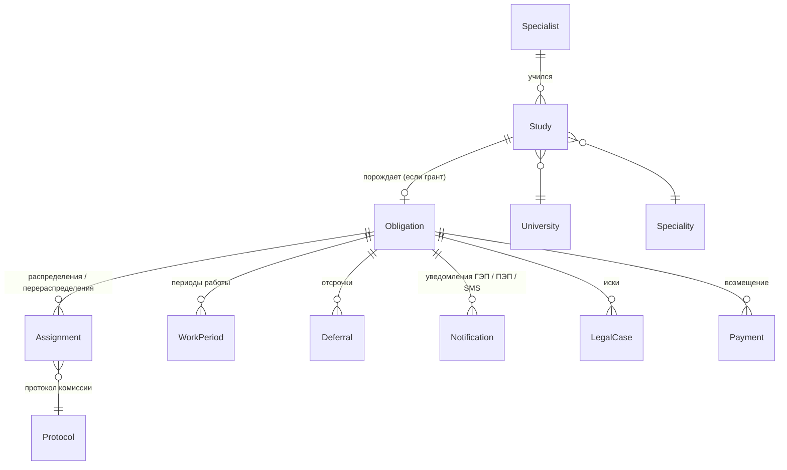

# Модель данных Jas Maman

> **Реализовано:** Study и Obligation объединены в один агрегат **Grant** (`Grants/States/GrantState.cs`) — они соотносятся 1:1 и проходят один жизненный цикл. Assignment, WorkPeriod, Deferral, Payment, Note — вложенные коллекции гранта; Notification — отдельная таблица (`Notifications`). Specialist отдельной сущностью не выделен: персональные данные хранятся в гранте, связь по ИИН.

Черновик для обсуждения. Основан на БП (`БП УМОСК.md`) и на том, как данные лежат в fin_center (`docs/fin_center-umosk.md`).

## Что учитываем из legacy

| Факт в fin_center | Вывод для модели |
|---|---|
| Признаки МС размазаны по `Персона` с префиксами по уровням (`умсМ_`, `умсР_`, `умсД_`, `отработано_бак/маг/…`) | Нужна отдельная сущность **«Обязательство»** на каждый уровень образования |
| `Зап_обучения`: 1,42 млн записей на 617 тыс. персон | Обучение — отдельная сущность, у человека их несколько |
| `Зап_отработки_МС`: 1,21 млн записей на 364 тыс. персон (в среднем 3,3), у 31 тыс. — по разным уровням | Распределение и периоды работы — история, привязанная к обязательству |
| Слово «статус» означает три разных вещи: движение (ct314), мониторинг (ct664/ct539), ТКС (ct360) | Три **независимых** поля статуса с отдельной историей |
| `Статус_УМС` (ct464) — это категория гранта | Назвать честно: `GrantCategory` |
| ТКС стоит у 91 тыс. персон по бакалавриату и 41 тыс. по магистратуре (ИП по маг. — 21 тыс.) | ТКС — на уровне обязательства, не персоны |
| Отсрочка записывается тремя способами (тип места, статус «Временная отсрочка», `срок_отсрочки`) | Отсрочка — отдельная запись с датами начала и окончания |

## Сущности

### Specialist — молодой специалист (человек)
Один на ИИН. ИИН, ФИО (+ склонения — для уведомлений), дата рождения, телефон (БМГ), адрес прописки (ГБД ФЛ), статус физлица (ГБД ФЛ: умерший, недееспособный…).
Legacy: `Персона` (ct320) + актуальная `Зап_перс_данных` (`ад_зап_перс_данных`, fallback `ид_зап_перс_данных`).

### Study — обучение на одном уровне
Уровень образования, категория гранта, вуз, специальность, форма и язык обучения, год поступления, год окончания, сумма бюджетных затрат, **текущее движение** (поступил / отчислен / закончил / ожидаемый выпуск…) + история движений с приказами (номер, дата, скан).
Legacy: `Зап_обучения` (ct322).

### Obligation — обязательство по отработке (ядро системы)
Возникает, когда обучение на гранте завершено. Один на (Specialist, уровень образования).

| Поле | Смысл |
|---|---|
| `MonitoringStatus` | Статус мониторинга: ожидает распределения, распределён, прибыл, КЦ, не прибыл, освобождён, отработал… |
| `RecoveryStatus` (ТКС) | Нет / ЮРДЕП / ИП / Архив / Архив по решению суда / … |
| `RequiredMonths`, `WorkedMonths` | Срок отработки и сколько отработано (сейчас `отработано_*_месяцев`) |
| `ReleaseReason` | Основание освобождения (ct436) |
| `TerminationReason` | Основание прекращения (ct438) |
| `Benefit` | Льгота при распределении (ct452) |
| `DebtAmount`, `PaidAmount` | Долг и оплачено (при возмещении) |

Каждое изменение статуса — **операция** (Yoda Op): кто, когда, основание, документ. Так история и аудит получаются автоматически (сейчас это `Зап_статуса_ТКС` и ручные примечания).

### Assignment — распределение / перераспределение
Протокол (основной или доп.), тип места (ct583), работодатель (БИН, наименование, КАТО), № и дата направления, льгота.

### WorkPeriod — период работы
Работодатель (БИН), даты с/по, источник подтверждения (МТСЗН / МИО / КЦ / документ МС), скан.

### Deferral — отсрочка
Тип (магистратура РК / магистратура за рубежом / докторантура / армия по призыву / армия по контракту / декрет…), дата начала, **дата окончания** (из-за неё — контроль «30 дней после диплома»), документ.

### Notification, LegalCase, Payment
Уведомления (ГЭП с трекингом КазПочты, ПЭП, SMS), иски (ct367 и движение по ним), платежи и справки. Детализируем, когда дойдём до этих этапов.

### University, Speciality
Справочники-сущности с собственными таблицами (их много, они меняются): вузы (ct317, 1 329 строк), специальности (ct316). КАТО — через RefsApi, как в keleshek.

## Справочники

По конвенции Yoda (как в keleshek) справочники, от которых зависит **логика**, — это enum в коде (`ReferenceEnum<T>`). Каждому enum соответствует таблица сопоставления legacy-значений (`код` из fin_center → значение enum), чтобы миграция не теряла ни одного значения.

| Enum | Legacy | Значений в legacy |
|---|---|---|
| `EducationLevel` | выводится из категории / движения | — |
| `GrantCategory` | ct464 Статус_УМС | 12 |
| `StudyMovement` | ct314 Движение | 40 |
| `MonitoringStatus` | ct664 Предварительный статус УМС | 23 |
| `RecoveryStatus` (ТКС) | ct360 Статус_заемщика_ткс | 8 |
| `PlacementType` | ct583 Разделение мест распределения | 19 (отсрочки вынесены в `DeferralType`) |
| `DeferralType` | часть ct583 + ct664 «Временная отсрочка» | — |
| `ReleaseReason` | ct436 Освобождение_от_отработки | 14 |
| `TerminationReason` | ct438 Прекращение_обязан_по_отработке | 13 |
| `Benefit` | ct452 Льгота_при_распределении | 2 |
| `StudyForm`, `StudyLanguage`, `ExpulsionReason` | ct454, ct524, ct574 | 5, 36, 14 |

## Открытые вопросы

1. **`MonitoringStatus`**: в legacy 23 значения, часть — уточнения (`Не прибыл (уведомлен)`, `… (нет ответа с МИО)`, `Прибыл (декрет)`). Переносить 1-в-1 или свести к базовым статусам + отдельный признак «уточнение»? Черновик: переносим 1-в-1, чтобы миграция была без потерь, упрощаем потом.
2. **`ct539 Статус мониторинга`** (workflow: «Передать в ЮРДЕП», «В ЮРДЕПе», «Возвращено…») пересекается с ТКС и ct664. Нужен ли он в новой системе отдельно — или его заменяет история операций?
3. **Префикс `аб_`** у ссылок Персоны (`аб_зап_обучения`, `аб_зап_отработки_МС`) — что означает? (`ад_` — актуальная, `ид_` — историческая, по аналогии с keleshek.)
4. **Платежи**: `Зап_род_оплаты` — всего 1 841 строка. Где реальные платежи МС?
